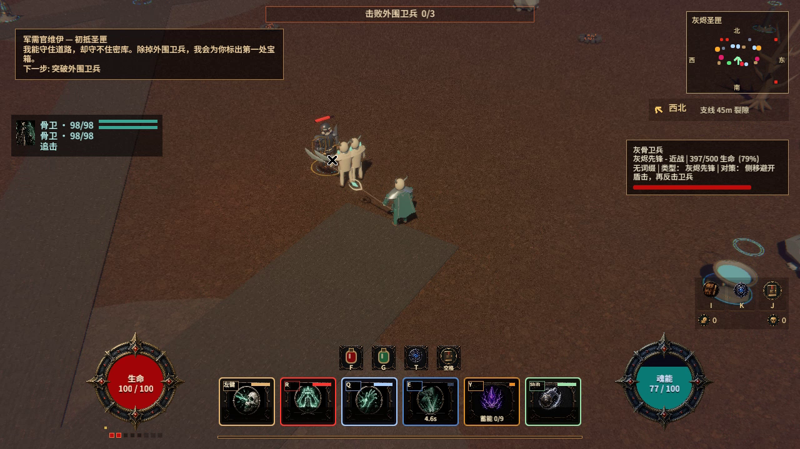
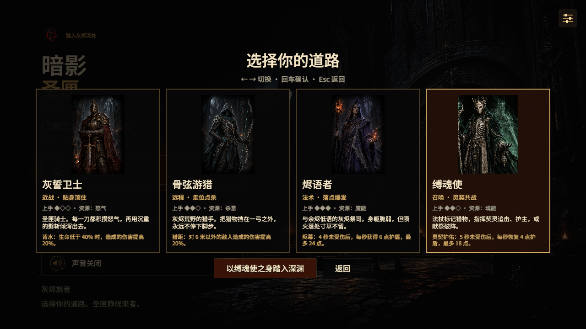
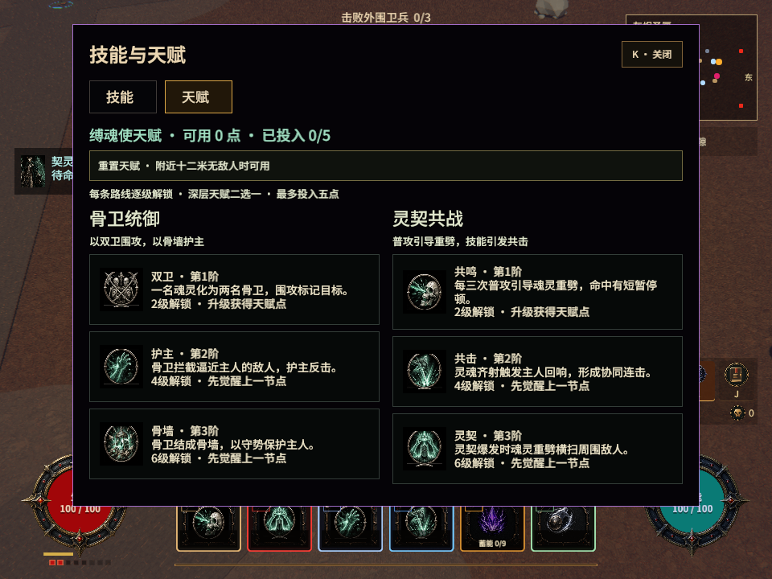

# 缚魂使验收（2026-10-05）

正常新局第四张职业卡进入缚魂使。六项指令、两条三阶天赋、专属模型与魂能、召唤物承伤/死亡/重聚均接入正式玩法；前三职业的新专精树仍是提案。

## 自动检查

- `cargo fmt --all -- --check`：通过。
- `cargo check --locked --all-features`：通过。
- `cargo clippy --locked --all-targets --all-features -- -D warnings`：通过。
- `cargo test --all-features --locked`：844项单元测试、17项素材清单、3项技能几何、7项召唤契约，总计871项通过。
- Python生成/捕获工具的 `py_compile`：通过。
- `cargo build --locked`：默认原生构建通过，无编译警告。
- 默认二进制 `--headless-smoke --no-audio --smoke-chapter=2 --smoke-frames=120`：通过，日志确认 Chapter II、1玩家、49区块、431场景物件、15交互物。
- `bash scripts/build_web.sh`：完整Web包正在构建，结果待补录。

日志位于 `target/soulbinder-*-final.log`，生成工具始终随素材提交。全量测试最初发现旧断言、TSV注释处理与新PNG透明通道问题，已修正并全量重跑。

## 原生真实输入

`tools/ui/capture_soulbinder.py` 使用隔离Xvfb窗口，真实职业选择和键鼠输入，每例14秒录像，检查接触、生命、资源、指令及位置遥测。固定装备/500生命目标仅出现在native的dev_tools准备场景，不进入正常游戏。

17例全部通过：待命、空挥、标记、齐击、双骨卫、灵契共击、归契、易魂、护阵、狂攻、祭爆、暂停、敌人近战、投射物、首领、敌群、普攻共鸣。完整录像、逐帧截图与JSON：`target/validation/soulbinder/`。

最终二进制另重录标记、双骨卫、共鸣3例，全部通过：`target/validation/soulbinder-final/`。同一装备下普通契灵命中16.2，第三次唯一普攻触发32.4重劈（两倍）；两骨卫均产生独立34伤害的齐击。狂攻实录普通命中26.7，符合1.65倍增幅。归契回到主人2米内；易魂实际换位并清除旧移动目标；护阵产生28护盾；献祭后生命归零并等待6秒重聚。近战、投射物和首领均真实降低契灵生命，敌群可令契灵自然死亡。

## 界面与素材

1280×720和960×720真实窗口截图复查四职业选择、固定确认按钮、技能和六天赋节点。960下快捷按钮已在面板后方，无遮字；零点点击仍保持0/5。技能图标可见，契灵生命条、剧情与魂能均中文，宠物卡与对白分开。23个剧情场景完整中文及切回英文由回归测试覆盖。

完整截图与输入记录：`target/validation/soulbinder/ui/`。

## 未验证的范围

默认headless日志仍有既有ICU4X日文分词模型缺失提示，未阻止启动；未在本轮处理该上游字体分词问题。没有完成整章通关、完整首领击败或长期经济/难度平衡测试；首领录像验证的是实际承伤。GUI成功购点与重置后连续战斗未实录，门槛、点数与互斥规则有单元测试，构筑效果由不同固定天赋的实机录像证明。录制关闭音频，未进行主观试听。地图使用既有边界/封闭门约束，未实现通用障碍寻路。Web构建不等于浏览器效果验收。前三职业18节点提案、更多敌人/地图品质与全游戏动态文案仍待后续开发和审计。
