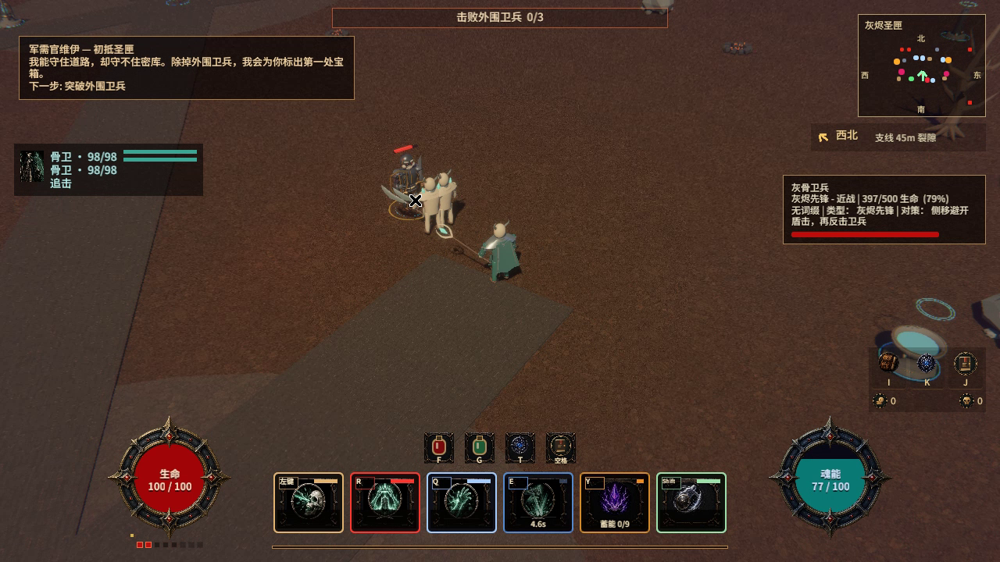
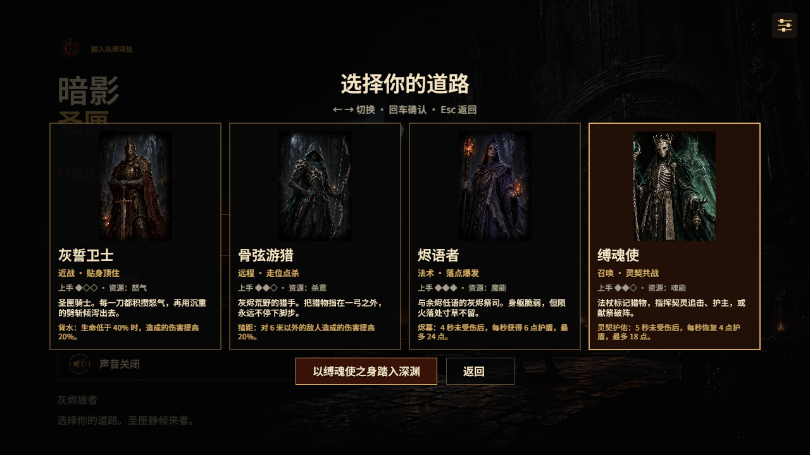
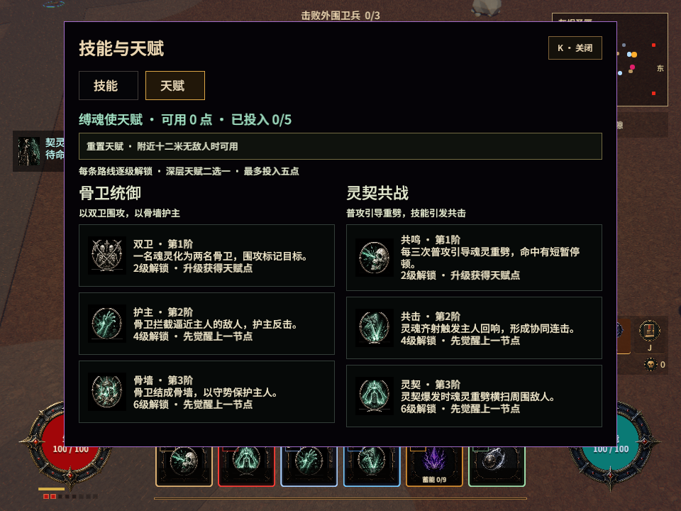

# 缚魂使验收（更新：2026-10-16）

正常新局第四张职业卡进入缚魂使。现为六项指令、两条六阶天赋（十二节点），等级延伸到20，偶数级授点，最多十点；前三职业的新专精树仍是提案。

## 本轮深层天赋

规则与取舍见 `SOULBINDER_DESIGN.md`。新增退守、围猎、不屈、残响、汲魂、传契；共享等级门槛2/4/6/10/14/18。六加四构筑、完整重置、真实升级、存档与章节携带均有新的回归测试；深层战斗使用真正的orders/behavior/apply_strike系统运行无窗口ECS测试，没有用手写模拟器替代。

- 格式、全功能check、全目标全功能Clippy：通过。
- `cargo test --locked --all-features`：861项单元测试、27项集成测试，共888项通过。日志 `target/talent-depth-tests.log`。
- 真正ECS回归通过：重劈→延迟追击仅一次、换标取消；双卫共用返魂8点冷却；围猎附加破绽且保留原出血符文；残血退回主人回血后再追击；首次阵亡1.2秒半血重聚、冷却内第二次6秒、主动献祭6秒；狂攻传契不额外造成伤害。
- ECS交互通过：逐次花10点购成6/4，超额拒绝，重置返还10点；等级不足不扣点。它不是鼠标/截图验收。
- 实际升级至20、偶数级授点、20级溢出进巅峰但不额外授点、等级20及6/4的RON存档/章节携带均通过。
- 最终原生全功能构建通过。第二章120帧无窗口启动通过（1玩家、49区块、431场景物件、15交互物），日志 `target/talent-depth-smoke.log`。无窗口日志仍有既有ICU4X分词模型提示。
- wasm32/WebGPU `cargo check --locked --target wasm32-unknown-unknown --no-default-features --features webgpu`（RUSTFLAGS选择wasm_js后端）：通过，无警告，日志 `target/talent-depth-wasm-check.log`。
- 本轮没有完成Web发布包或浏览器运行验收。
- 新UI及六个深层节点实机录像：**未通过验收**。Xvfb创建AF_UNIX套接字被当时sandbox拒绝（Operation not permitted），现有显示也无法连接；没有新版截图/鼠标购点成功证据。失败日志 `target/validation/talent-depth-ui-first/soulbinder-tree/xvfb.log`。准备好的录制器 `tools/ui/capture_talent_depth.py` 可在允许本地显示的终端复录。
- 尚未做整章通关与长期平衡；7444XP是成长曲线的精确累计，不是已经通关的实测时长。

## 此前基础机制基线（三阶版本）

以下测试数量、17段实机和图片属于之前三阶版本，不能替代本轮十二节点的全部验证。

## 自动检查

- `cargo fmt --all -- --check`：通过。
- `cargo check --locked --all-features`：通过。
- `cargo clippy --locked --all-targets --all-features -- -D warnings`：通过。
- `cargo test --all-features --locked`：844项单元测试、17项素材清单、3项技能几何、7项召唤契约，总计871项通过。
- Python生成/捕获工具的 `py_compile`：通过。
- `cargo build --locked`：默认原生构建通过，无编译警告。
- 默认二进制 `--headless-smoke --no-audio --smoke-chapter=2 --smoke-frames=120`：通过，日志确认 Chapter II、1玩家、49区块、431场景物件、15交互物。
- `bash scripts/build_web.sh`：发布构建多次随会话中断，日志停在游戏模块编译；未获得完整成功记录，不能作为通过。旧 `web/pkg` 不是本轮最终源码的发布证据。
- `RUSTFLAGS='--cfg getrandom_backend="wasm_js"' cargo check --locked --target wasm32-unknown-unknown --no-default-features --features webgpu`：通过，9分09秒，无警告。日志：`target/soulbinder-wasm-check-final.log`。

日志位于 `target/soulbinder-*-final.log`，生成工具始终随素材提交。全量测试最初发现旧断言、TSV注释处理与新PNG透明通道问题，已修正并全量重跑。

## 原生真实输入

`tools/ui/capture_soulbinder.py` 使用隔离Xvfb窗口，真实职业选择和键鼠输入，每例14秒录像，检查接触、生命、资源、指令及位置遥测。固定装备/500生命目标仅出现在native的dev_tools准备场景，不进入正常游戏。

17例全部通过：待命、空挥、标记、齐击、双骨卫、灵契共击、归契、易魂、护阵、狂攻、祭爆、暂停、敌人近战、投射物、首领、敌群、普攻共鸣。完整录像、逐帧截图与JSON：`target/validation/soulbinder/`。

最终二进制另重录标记、双骨卫、共鸣3例，全部通过：`target/validation/soulbinder-final/`。同一装备下普通契灵命中16.2，第三次唯一普攻触发32.4重劈（两倍）；两骨卫均产生独立34伤害的齐击。狂攻实录普通命中26.7，符合1.65倍增幅。归契回到主人2米内；易魂实际换位并清除旧移动目标；护阵产生28护盾；献祭后生命归零并等待6秒重聚。近战、投射物和首领均真实降低契灵生命，敌群可令契灵自然死亡。

## 界面与素材

1280×720和960×720真实窗口截图复查四职业选择、固定确认按钮、技能和六天赋节点。960下快捷按钮已在面板后方，无遮字；零点点击仍保持0/5。技能图标可见，契灵生命条、剧情与魂能均中文，宠物卡与对白分开。23个剧情场景完整中文及切回英文由回归测试覆盖。

完整截图与输入记录：`target/validation/soulbinder/ui/`。

## 未验证的范围

默认headless日志仍有既有ICU4X日文分词模型缺失提示，未阻止启动；未在本轮处理该上游字体分词问题。没有完成整章通关、完整首领击败或长期经济/难度平衡测试；首领录像验证的是实际承伤。GUI成功购点与重置后连续战斗未实录，门槛、点数与互斥规则有单元测试，构筑效果由不同固定天赋的实机录像证明。录制关闭音频，未进行主观试听。地图使用既有边界/封闭门约束，未实现通用障碍寻路。Web构建不等于浏览器效果验收。前三职业18节点提案、更多敌人/地图品质与全游戏动态文案仍待后续开发和审计。

提交状态（2026-10-17）：权限已恢复，本轮源码、配置、测试和文档统一提交为 `feat: deepen Soulbinder talent progression`。窗口和浏览器验收仍以上述实际记录为准，权限恢复不代表它们已自动通过。
